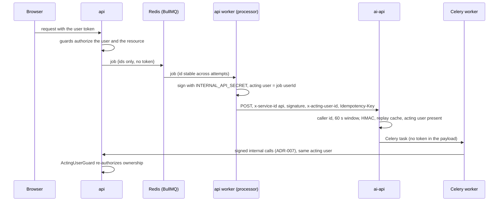

# api to ai-api Service Identity and Queue Hygiene

> **Status**: `planned` · **Owner**: `architect` · **Last reviewed**: `2026-10-09`
>
> How the work that `api` queues for `ai-api` is authorized by a signed service identity and an acting user, so that no user token is stored in Redis or forwarded.

Decision source: finding H-002 of [security-audit.md](../01-audit/security-audit.md#h-002), the mirror image of [ai-api-service-identity.md](./ai-api-service-identity.md) (direction `ai-api` to `api`, ADR-007). Decision record: [ADR-013](../decisions/ADR-013-api-to-ai-api-service-identity.md). Tasks: [api-to-ai-api-service-identity-plan.md](../plans/api-to-ai-api-service-identity-plan.md). The same change repairs the queue path of finding H-001, because the new client is the only place that talks to `ai-api` from a job.

---

## Purpose

Describes the credential, the job payloads, the verification on the FastAPI side, the failure handling of the three BullMQ processors, and the edge rules in nginx that keep the internal contract off the public network.

Out of scope, each with its owner decision:

| Not covered | Why | Tracked as |
|---|---|---|
| Browser to `ai-api` calls (`/learning/chat`, `/users-steps/generate-question`) | they keep the user's own bearer token; routing them through `api` is the open decision D-13 | `docs/strategy/decision-register.md` D-13 |
| `v1/agents/` forwarding the user's bearer to `api` | waits for the agent runtime design | audit row 6 |
| Content embedding (`ContentProcessor`) | the route it calls does not exist in `ai-api`; implementing it needs the retrieval metadata contract | C-002, audit row 4a |

## Research

Sources read on 2026-10-09. The quotations are the sentences the page fetch returned; the fetch tool summarizes long pages, so check the wording against the page before quoting it elsewhere. Where a page does not say something, the right-hand column says so.

| Source | What it says | Consequence for this design |
|---|---|---|
| [OWASP Microservices Security Cheat Sheet](https://cheatsheetseries.owasp.org/cheatsheets/Microservices_Security_Cheat_Sheet.html) | "Propagate authenticated user context in a form each receiving service can validate" and "authenticate the calling service separately"; "Each service must enforce access to its protected operations, including internal calls"; "A signature protects an assertion's integrity; it does not itself grant access to a requested resource." It does not say that user tokens must not be forwarded or stored | Every call carries two things: the calling service and the acting user. `ai-api` authorizes the operation itself instead of trusting that `api` was careful |
| [OWASP Identity Propagation Patterns Cheat Sheet](https://cheatsheetseries.owasp.org/cheatsheets/Identity_Propagation_Patterns_Cheat_Sheet.html) | "forwarding a bearer token to more services increases the places from which it can leak"; for a service that forwards user attributes it signs itself, "Every service trusted to supply these attributes can misrepresent them"; "Signing protects integrity; it does not hide claims, prevent bearer-token replay, or compensate for a compromised issuer"; "Do not widen token audiences merely to make forwarding work"; "limit the assertion's recipients and lifetime". It does not cover queued work | The user token stops travelling (Redis, header, body). Only `api`, which owns identity, may assert a user, so `ai-api` accepts exactly one caller id. The assertion is bound to one request (method, path, body, timestamp), has a 60 s life, is checked against a replay cache, and is valid for one audience through a per-direction key |
| [RFC 8693, OAuth 2.0 Token Exchange](https://www.rfc-editor.org/rfc/rfc8693.html) | Delegation keeps both identities: "principal A still has its own identity separate from B"; impersonation gives A all of B's rights. `audience`, `scope` and a short lifetime limit what an issued token can do; a security token service adds an issuance step | The model is delegation: actor `api`, subject the user, both visible to `ai-api`. A full token exchange needs a token service for two co-located services, so it is not adopted; its constraints (audience, scope by route, short life) are |
| [RFC 9421, HTTP Message Signatures](https://www.rfc-editor.org/rfc/rfc9421.html) | Signature parameters `created`, `expires`, `nonce`, `keyid`, `tag`; `tag` is "an application-specific tag" that tells which signatures are meant for an application; a profile must fix the covered components, the parameters, key retrieval and the allowed algorithms; coverage "has to be sufficient for the application". The page text fetched stopped before the replay section | The existing HMAC scheme is a profile with the same ingredients: timestamp (`created`), service id (`keyid`), per-direction secret (the role of `tag`), method, target, body hash and acting user as covered components. The RFC wire format is not adopted: both sides already share vectors and a guard, and no maintained library for both runtimes is in the repository. It stays the migration target if a third service appears |
| [BullMQ, Job Data](https://docs.bullmq.io/guide/jobs/job-data) | "Job data is sent through Redis as a string" (JSON). It gives no sizing or sensitive-data guidance | Everything in a job is at rest in Redis. Here Redis runs with `--appendonly yes` (`docker-compose.yml`), and failed jobs are kept because `queue.config.ts` sets no `removeOnFail`. A token in a job is therefore written to disk and kept |
| This repository | the access token lives 15 minutes (`.env.example`, `JWT_ACCESS_EXPIRES_IN=15m`); the queue retries with a delay | A queued token is both a leak and a defect: a job that waits or retries for more than 15 minutes fails with 401 |

## Current state

Measured on `HEAD cb0572f` plus the working tree of 2026-10-09; the nginx rows were probed on the running stack.

| # | Flow | Credential today | Problems |
|---|---|---|---|
| 1 | `PersonalityQuizzesController.submitAttempt` → `addUserStepsJob` → `UserStepsProcessor` → `POST {AI_URL}/users-steps/generate` and `/learning/generate-material` | the user's access token in the job (`personality-quizzes.controller.ts:33-56`, `personality-quizzes.service.ts:168`), sent as `Authorization: Bearer` and again as `token` in the JSON body (`user-steps.processor.ts:47-52,83`) | token at rest and in transit; no `Idempotency-Key`, which `ai-api` requires (`mint_if_missing=False`), so every call is 400; a 200 response with an `{error}` body is stored as a user step; the per-step `catch {}` hides every failure |
| 2 | `ResourcesController.create` → `addKnowledgeJob` → `KnowledgeProcessor` → `POST {AI_URL}/resources/embedding/{id}` and `/resources/extract` | the user's access token (`resources.controller.ts:15-18`, `resources.repo.ts:109-115`, `knowledge.processor.ts:34,46`) | token at rest; the embedding call never checks `res.ok` |
| 3 | `ContentsRepo.update` → `addContentEmbeddingJob` → `ContentProcessor` → `POST {AI_URL}/v1/resources/embedding/content` | none | `AI_URL` already ends in `/ai/v1`, so the URL is `/ai/v1/v1/...`; `ai-api` has no such route (`v1/resources/router.py` has `/extract` and `/embedding/{resource_id}` only) |
| 4 | `ai-api` side | `resources/*` calls `authenticate(Authorization, {TEACHER, ADMIN})`; `learning` and `users_steps` use `authenticated_user`; both introspect the token against `GET /auth/profile` (`config/user_auth.py:12-61`) | a learner token can call `users-steps/generate` and `learning/generate-material` directly, although only the queue needs them |
| 5 | edge | nginx proxies `/api/` and `/ai/` as they come | `GET /api/v1/internal/lessons/<id>` answers 401 from outside (reachable, guarded only by the HMAC); `x-service-*` headers sent from outside reach `ai-api`; after a recreate of `ai-api`, nginx kept the old IP and answered 502 until a reload (observed 2026-10-09) |

The browser calls two routes of `ai-api` directly: `/learning/chat` and `/users-steps/generate-question` (`apps/web/app/services/chat/chatMessages.ts:91`, `personalityQuiz.ts:71`). The other four routes in rows 1 and 2 are used by the queue only.

## Conceptual model



Who asserts what:

| Hop | Asserter | Verifier | Secret | What the verifier decides |
|---|---|---|---|---|
| browser to `api` | the user (JWT) | `api` guards | `JWT_ACCESS_SECRET` | the user's role and ownership |
| `api` to `ai-api` (this document) | `api`, as service `api`, on behalf of the acting user | `ai-api` | `INTERNAL_API_SECRET` | the call comes from `api`, is fresh, is unmodified and was not replayed; the acting user is the one `api` authorized |
| `ai-api` to `api` (ADR-007) | `ai-api`, as service `ai-api`, on behalf of the acting user | `api` | `INTERNAL_AI_API_SECRET` | the call comes from `ai-api`; ownership of the resource for the acting user |

The two secrets differ on purpose. The canonical string does not contain the caller id, so with one shared secret a request that `ai-api` signed for `api` could be replayed to `ai-api` as if `api` had signed it. Two secrets make each signature valid for one audience only, which is the role `tag` plays in RFC 9421.

## Schema

Request contract, `api` to `ai-api`:

```text
x-service-id          "api"; the only caller id ai-api accepts on a service route
x-service-timestamp   epoch milliseconds, within 60 s of the ai-api clock
x-service-signature   hex HMAC-SHA256(INTERNAL_API_SECRET, canonicalString)
x-acting-user-id      the user api authorized; mandatory
x-trace-id            the job trace id
Idempotency-Key       mandatory (also sent as x-idempotency-key)
canonicalString       timestamp \n METHOD \n path+query \n sha256(rawBody) \n actingUserId
```

The canonical string is the one of ADR-007 after amendment A1; the implementations and the shared vectors already exist in both languages.

Job payloads after the change; a payload that holds a token is no longer representable:

```typescript
export interface UserStepsJob {
  userId: string;
  topicId: string;
  lessonId: string;
  learningStyleId: string;
  quizId: string;
}

export interface KnowledgeJob {
  resourceId: string;
  userId: string;
}

export interface ContentEmbeddingJob {
  contentId: string;
  chatId: string;
  textContent: string;
}
```

`QueueService` validates each payload with a strict Zod schema before `Queue.add`; a key that matches `/token|authorization|secret|password|cookie/i` is rejected by name as well, so a future field cannot reintroduce the problem.

`api` client:

```typescript
export interface AiServiceRequest {
  path: string;
  query?: Record<string, string>;
  body?: unknown;
  actingUserId: string;
  idempotencyKey: string;
  traceId?: string;
  timeoutMs?: number;
}

export class AiServiceClient {
  post<T = unknown>(request: AiServiceRequest): Promise<T>;
}

export class AiServiceError extends Error {
  readonly status: number | null;
  readonly retryable: boolean;
}
```

`ai-api` verification:

```python
@dataclass(frozen=True)
class ServiceCaller:
    service_id: str
    acting_user_id: str
    trace_id: str | None


async def service_actor(request: Request) -> dict:
    ...
```

`service_actor` returns `{"id": <acting user id>, "via": "service"}`. The parameter keeps the name `user`, because the rate limiter and the idempotency store read `kwargs["user"]["id"]` to scope their keys.

Route classes on `ai-api`:

| Class | Dependency | Routes |
|---|---|---|
| user | `authenticated_user` (bearer, introspected) | `POST /learning/chat`, `GET /users-steps/generate-question`, `POST /agents/run` |
| service | `service_actor` (signature only) | `POST /users-steps/generate`, `POST /learning/generate-material`, `POST /resources/extract`, `POST /resources/embedding/{id}` |

A route has one mode. A bearer token no longer works on a service route, and a service signature does not work on a user route.

Configuration: `INTERNAL_API_SECRET` is listed for `api` and `ai-api` only, never for `celery-worker`, `web` or the shared AI environment anchor; `scripts/check-compose-env.py` enforces it.

## Algorithms

Producing a job (`api`):

1. The controller's guards authorize the user and the resource as today (`@Roles(TEACHER)` on resource creation, `@RequireOwnership('personality-quiz')` on a quiz submission).
2. The service passes `req.user.id`, never a body field, as `userId`; the token argument disappears from the controller, service and repository signatures.
3. `QueueService.add*` validates the payload and adds the job with `attempts: 3`, exponential backoff and `removeOnFail: { age: 604800, count: 500 }`.

Processing a job (`api` worker):

1. The idempotency key is `sha256(queue : job.id : path : canonical body)`. `job.id` is the same on every attempt, so a retry after a lost response is a replay, not a second run.
2. `AiServiceClient.post` serializes the body once, signs those bytes with the target `pathname + search` of the final URL, and sends them with a timeout (30 s by default, 120 s for `users-steps/generate`, which runs the pipeline synchronously).
3. A network error, a timeout, 408, 429 and 5xx are retryable; other 4xx are not and end the job with BullMQ's `UnrecoverableError`.
4. A 2xx response whose JSON object has an `error` key is a failure; this is how `ai-api` reports a pipeline failure today (finding H-001).
5. `UserStepsProcessor` keeps its per-step isolation (a failed step does not stop the others, and repeating the whole job would create duplicate user steps) but logs the step id and the error and returns the list of failed steps; it throws only when every step failed.

Verifying a service request (`ai-api`, `service_actor`):

1. `x-service-id`, `x-service-timestamp` and `x-service-signature` are present, else 401.
2. The id is `api` and `INTERNAL_API_SECRET` is configured, else 401 (fails closed).
3. `|now - timestamp| ≤ 60 s`, else 401.
4. The HMAC over method, `path + "?" + query` as received, SHA-256 of the raw body and the acting user matches, compared in constant time, else 401.
5. `x-acting-user-id` is present, else 400.
6. Replay cache: `SET internal:replay:api:<signature> NX EX 120` in Redis; a repeat is 401. When Redis is unreachable the verifier logs a warning and continues, as the `api` guard does; the 60 s window and the idempotency store still apply.
7. Every failure answers the same 401 body; the reason is only in the log.

If any `x-service-*` header is present on a user route, the route ignores it and still requires the bearer token; there is no downgrade or upgrade between modes.

Legacy jobs: at startup `api` scrubs every retained job (waiting, delayed, failed, paused, prioritized) of token-like keys with `Job.updateData`, logs how many it changed, and does nothing when there are none. After the first deploy an operator runs `redis-cli BGREWRITEAOF` so that the append-only file no longer holds the old values.

Edge (nginx):

1. `location ^~ /api/v1/internal/ { return 404; }`: internal routes are used by `ai-api` over the Docker network, never through nginx.
2. On `/api/` and `/ai/`, `proxy_set_header` blanks `x-service-id`, `x-service-timestamp`, `x-service-signature` and `x-acting-user-id`, so a service identity cannot be presented from outside.
3. The upstream blocks use `resolver 127.0.0.11 valid=10s ipv6=off;`, a `zone` and `server <name>:<port> resolve`, so a recreated container is found without a reload (nginx 1.27.5 supports `resolve` in the open-source build; `nginx -t` in the container decides).

Edge cases:

| Case | Behavior |
|---|---|
| a job created before the change still holds `token` | the processor ignores the key; the startup scrub removes it |
| the clock of `api` and `ai-api` differ by more than 60 s | every queued call is 401 and retried; the job fails with a clear status after three attempts |
| the same job attempt is delivered twice | same idempotency key: `ai-api` replays the first response |
| `ai-api` answers 200 with `{ "error": ... }` | the client throws, the key is released by the `ai-api` decorator, the retry runs again |
| `ai-api` is down | connection errors are retryable; the job fails after backoff and stays visible in BullMQ for seven days |
| `INTERNAL_API_SECRET` missing on `ai-api` | service routes answer 401 to everything; the browser routes are unaffected |

## Trade-offs

| Option | Verdict |
|---|---|
| A. Forward the user's token (today) | rejected: the token sits in Redis and on disk, travels in header and body, expires in 15 minutes, and grants the queue far more than one call |
| B. Encrypt the token inside the job | rejected: the leak shrinks but the expiry defect and the over-broad credential remain, and a key management problem is added |
| C. A long-lived service account token or the refresh token in the job | rejected: a longer-lived bearer credential in Redis is worse than the problem |
| D. Token exchange at a security token service (RFC 8693) | not adopted: a new service and an issuance dependency for two co-located services; its audience, scope and lifetime rules are adopted instead |
| E. Signed per-request service identity plus the acting user | chosen: nothing reusable is stored, the credential is bound to one request and one audience, it reuses the guard, the vectors and the client pattern of ADR-007, and the acting user stays visible to the verifier |
| F. mTLS between the services with the acting user in a header | not chosen: needs certificate issuance and rotation in compose, and the acting user would still need its own integrity protection |
| G. Asymmetric signatures (Ed25519) | not chosen now: it would stop a compromised verifier from forging requests, but the verifier here is the AI service the caller already trusts for the same operations; revisit with a third service |
| H. `ai-api` pulls work from `api` | not chosen: a second protocol and polling for the same trust relationship |
| I. One secret for both directions | rejected: a request signed for one direction could be replayed in the other; two secrets give audience separation without changing the canonical string |
| J. Keep both modes on every route | rejected: it keeps the learner-reachable path to LLM spend and an ambiguous contract; one mode per route is simpler to test and to reason about |

Residual risk: `api` can assert any acting user to `ai-api`. That is inherent to a service that owns identity, and it adds no capability, because `api` is already the system of record; every effect of `ai-api` on data goes back through the signed routes that re-authorize ownership. A compromised `ai-api` holds both secrets, but each lets it call only the services it already calls.

## Migration notes

- **Secret**: generate `INTERNAL_API_SECRET` for every environment (`openssl rand -base64 48`); add a placeholder to `.env.example`; list it for `api` and `ai-api` in both compose files; the compose gate forbids it elsewhere.
- **Order**: `ai-api` first (the service routes accept a signature, which no caller sends yet), then `api` (signs, no longer enqueues tokens), then the nginx change. Between the two deploys the queue path is the broken path of today, not a new one.
- **Existing tests**: the router authentication tests cover `learning/chat`, a user route, and stay valid; tests of the four service routes move from bearer to signature.
- **Behavior changes**: jobs that failed silently now fail visibly and are retried; `users-steps/generate` and `learning/generate-material` are no longer callable with a learner token; internal routes and `x-service-*` headers are no longer reachable from outside nginx.
- **Docs**: `AGENTS.md` cross-service rule 2 and the internal contract name the new direction; "Open violations" loses H-002; the security audit keeps its text as a snapshot and the tracker records the closure.
- **Follow-up**: key rotation without downtime (a verifier that accepts the current and the previous secret) is not part of this change.

## Evidence citations

- `services/api/src/v1/queue/queue.service.ts:13-34`, `queue.config.ts`, `queues/{user-steps,knowledge,content}.processor.ts`
- `services/api/src/v1/learning/personality-quizzes/personality-quizzes.controller.ts:33-56`, `personality-quizzes.service.ts:168`, `services/api/src/v1/material/resources/resources.controller.ts:15-18`, `resources.repo.ts:109-115`
- `services/ai-api/v1/resources/router.py`, `v1/learning/router.py`, `v1/users_steps/router.py`, `config/user_auth.py`, `config/service_auth.py`
- `infra/nginx/nginx.conf:54-66,114-148`, `docker-compose.yml` (redis `--appendonly yes`), `.env.example:32`
- Live probes of 2026-10-09: internal route through nginx 401, `/ai/` 502 after the recreate and 200 after `nginx -s reload`
